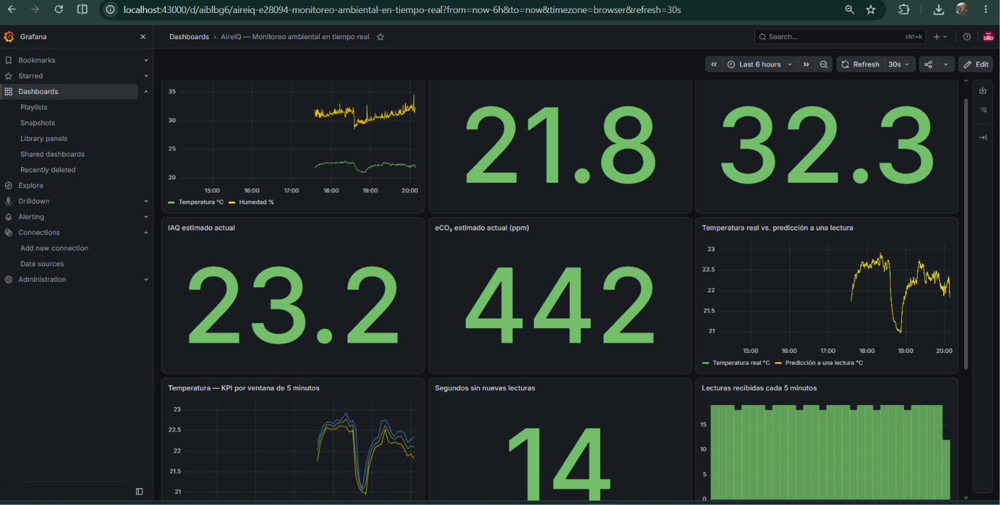
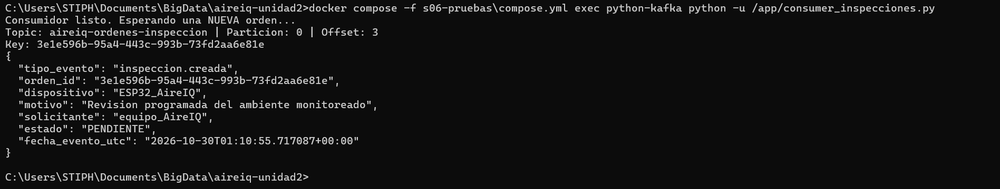
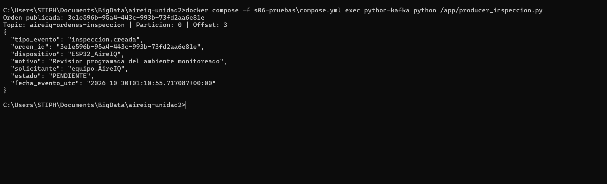
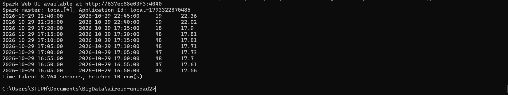
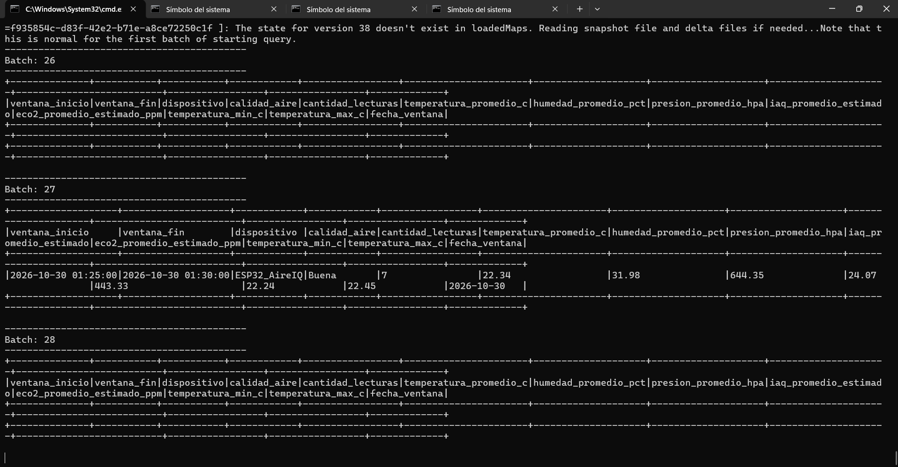
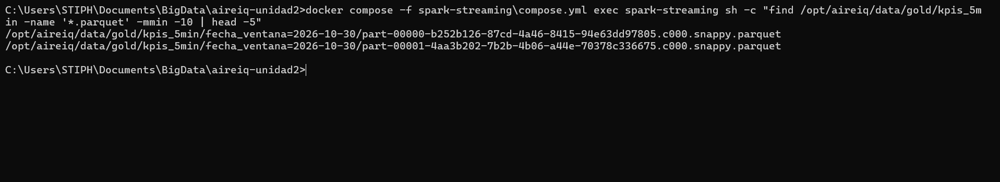

---

layout: default

title: Evidencias — AireIQ Unidad II

---

# Evidencias de AireIQ — Unidad II

Estas capturas documentan el flujo real utilizado en la evaluación. Los comandos, contratos y resultados se explican en el [producto U2](u2-producto.html).

## Dashboard operativo y BI

Grafana reúne variables ambientales, KPIs por ventanas de cinco minutos, frescura del flujo y predicción de temperatura.

## Evento empresarial en Kafka

El productor publicó una orden de inspección. El consumidor recibió la misma orden, con la partición y el offset correspondientes.

## Procesamiento con Spark

La consulta Gold mostró ventanas de cinco minutos con lecturas y temperatura promedio del dispositivo.

Spark Structured Streaming procesó un batch nuevo mientras llegaban lecturas reales.

Después se comprobaron archivos Parquet recientes en la salida Gold.

[Volver al inicio](index.html)
